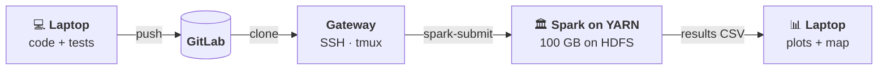
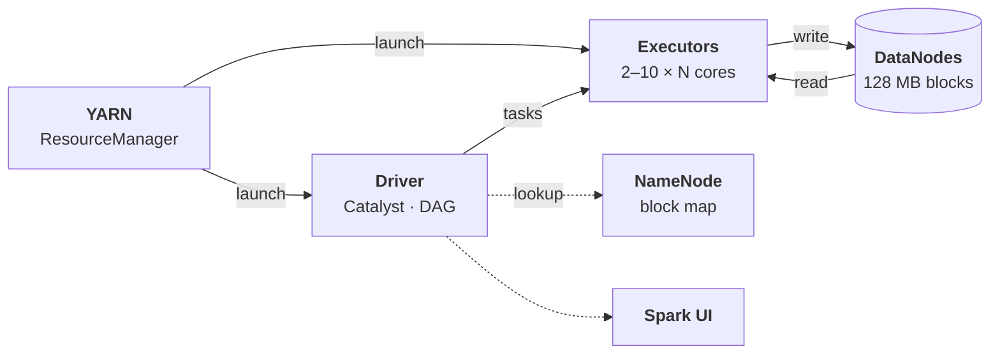
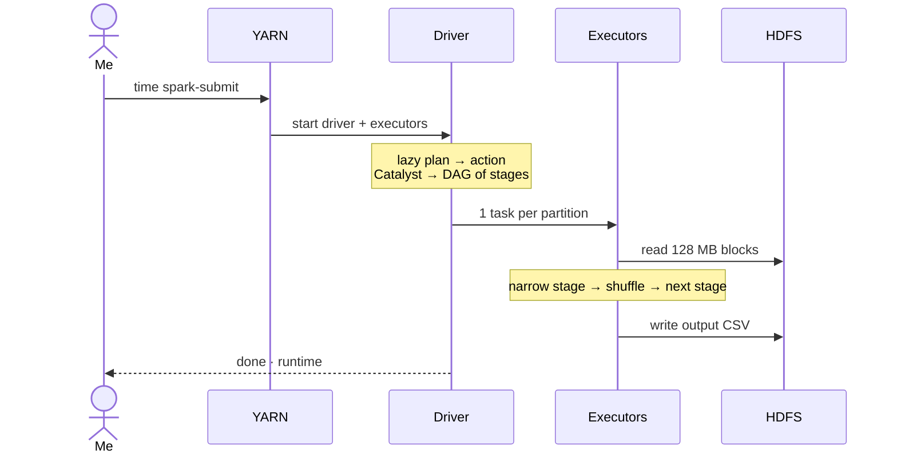
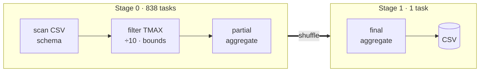
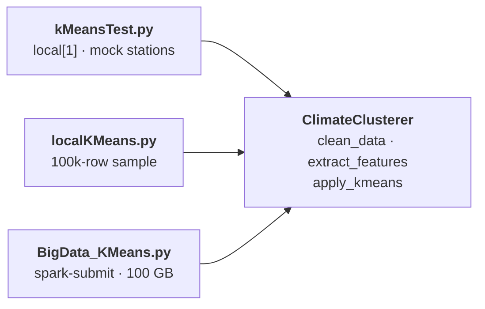
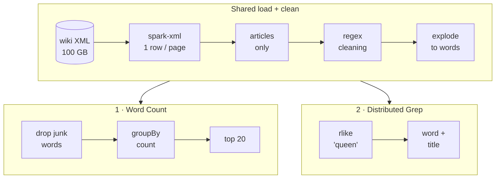
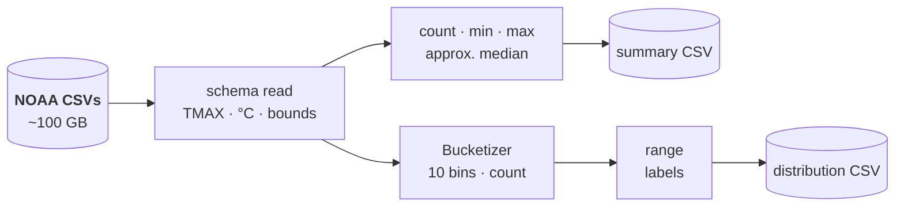
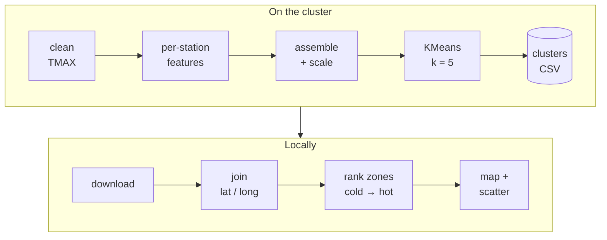

# Massive-Scale Data Analytics with Apache Spark

> BSc Computer Science Final Year Project, Royal Holloway, University of London (2025–26)
> **Arbaaz Ali Jaffer**

Four distributed data-processing programs written in **PySpark** and run on the university's
Big Data cluster (HDFS + YARN) over two **~100 GB datasets**. The project also includes a
performance study of how the Spark configuration (executors, cores, memory, shuffle partitions,
dataset size) affects runtime and throughput.

| # | Program | Dataset | Spark features used |
|---|---------|---------|---------------------|
| 1 | **Word Count** | Wikipedia XML dump (100 GB) | DataFrame API, `spark-xml`, regex cleaning, `explode` / `groupBy` |
| 2 | **Distributed Grep** | Wikipedia XML dump (100 GB) | Same cleaning pipeline, `rlike` pattern matching that returns the matching article titles |
| 3 | **Statistical Analysis** | NOAA GHCN-Daily weather, 1900–2025 (~100 GB) | Explicit schema, `percentile_approx`, MLlib `Bucketizer` frequency distribution |
| 4 | **K-Means Clustering** | NOAA GHCN-Daily weather (~100 GB) | MLlib `VectorAssembler`, `StandardScaler`, `KMeans` to group weather stations into temperature zones |

🎥 **Demo video:** <https://www.youtube.com/watch?v=Q9mJMntAv3c>
📄 **Full report:** [`documents/ArbaazJaffer.final.pdf`](documents/ArbaazJaffer.final.pdf)

### 🌍 Final result: global temperature zones from 100 GB of weather data

<a href="https://arbzzz04.github.io/spark-massive-scale-analytics/map/">
  
</a>

Spark MLlib K-Means (k = 5) clustered **40,179 weather stations** using 125 years of daily maximum temperatures.
No location data went into the model, yet the zones it found match real climate bands: Canada, Scandinavia and
Russia in the coldest zones, and Mexico, Africa, India, South-East Asia and Australia in the hottest.
**[▶ Open the interactive map](https://arbzzz04.github.io/spark-massive-scale-analytics/map/)** to zoom in and hover
over any station. You can also download [`docs/map/index.html`](docs/map/index.html) and open it in a browser.

---

## Contents

- [Architecture](#architecture)
- [How each program works](#how-each-program-works)
- [Results & performance analysis](#results--performance-analysis)
- [Repository layout](#repository-layout)
- [How it was set up and run on the cluster](#how-it-was-set-up-and-run-on-the-cluster)
- [Running locally](#running-locally)
- [Key learnings](#key-learnings)

---

## Architecture

The project ran on the university's Big Data cluster. Hadoop **HDFS** stored the data, **YARN** handed out the
compute, and **Apache Spark** (through PySpark) ran the jobs. According to the CIM help desk, the "cluster" was
**ten virtual-machine executors on a single physical server**. That detail explains a lot of the scaling behaviour in
the [results](#results--performance-analysis).

### 1. End-to-end workflow



Code was written and unit-tested locally, tracked on GitLab (issues, feature branches, merge requests), then
cloned onto the cluster's gateway node over SSH. Each 100 GB job was launched with `time spark-submit` inside a
`tmux` session, so a dropped connection couldn't kill it. Only the small result CSVs came back to the laptop for
plotting, so a chart could be changed without rerunning a 100 GB job.

### 2. Inside the cluster



| Component | Role in this project |
|---|---|
| **YARN ResourceManager** | Grants the `--num-executors`, `--executor-cores` and `--executor-memory` requested by `spark-submit`. These were the independent variables in the experiments. |
| **Driver** | Runs the PySpark script. Catalyst optimises the query plan, and the DAG scheduler splits it into stages and tasks. |
| **Executors** | Run tasks in parallel, roughly one HDFS block per task. All 10 share one server's CPU, RAM, disk and network, which is why speed-ups flatten after about 6–8 executors. |
| **NameNode / DataNodes** | HDFS splits files into 128 MB blocks, each replicated 3×. The NameNode tracks where every block lives, so tasks can be scheduled next to their data. |
| **Spark UI** | Used to watch stage progress, executor memory and the DAG, for example to confirm that the regex transformations were pipelined into a single stage. |

### 3. Lifecycle of one job



Every program is a chain of **lazy** DataFrame transformations ending in one **action** (`show()` or `write`).
Nothing runs until that action is reached. Then Catalyst optimises the whole chain, merges consecutive *narrow*
operations (`filter`, `withColumn`, `regexp_replace`) into one stage, and starts a new stage only where a *wide*
operation needs a **shuffle**.

### 4. Stages and shuffles

This is the real DAG the Spark UI showed for the Statistical Analysis summary job:



The bulk of the work runs in the 838-task narrow stage, and only small partial results cross the network. How much
each program has to shuffle is what separates their scaling:

| Program | Wide operations | Shuffle cost | Speed-up at 10 executors |
|---|---|---|---|
| Distributed Grep | none: `explode` + `rlike` filter only | none | **10.6×** (vs 1 executor) |
| Word Count | `groupBy(word)` + `orderBy(count)` | large: every distinct word | **9.3×** (vs 1 executor) |
| Statistical Analysis | global aggregate + `groupBy(bucket)` | tiny (~67 MB) | **3.4×** (vs 2 executors) |
| K-Means | `groupBy(STATION)` + a shuffle on every iteration | 1.0–1.8 GB, grows with partitions | **3.0×** (vs 2 executors) |

### 5. Code design



The interim programs (Word Count and Grep) are straightforward procedural scripts. For the final phase I switched
to **test-driven, object-oriented code**. `ClimateClusterer` takes an optional `spark_session`, so the same class
runs unchanged in the unit tests, the local prototypes and the full cluster job. The statistical analysis functions
are pure functions tested with **pytest** and PySpark's `assertDataFrameEqual`.

---

## How each program works

### Text workloads: Wikipedia XML (Problems 1 & 2)



**Shared load + clean** (narrow transformations, no shuffle):
1. Read the XML dump with `spark-xml`, using `rowTag="page"` so that each `<page>` becomes one row.
2. Keep only real articles (`ns == 0`, not redirects, text not null) and pull out `revision.text`.
3. Clean the text with built-in Spark SQL functions rather than UDFs, so Catalyst can optimise them: lowercase it, strip `[[links]]`, `{{templates}}`, `<ref>` and HTML tags and URLs, keep only `a–z`, and drop single letters other than *a* and *i*.
4. `split` + `explode` into one row per word.

#### 1. Word Count: [`product/BigData_WikiWordCount.py`](product/BigData_WikiWordCount.py)
Drops numeric tokens and markup junk words (`infobox`, `wikitable`, `colspan`, …), then
`groupBy("word").count().orderBy(desc)`. The `groupBy` is a wide transformation and triggers the shuffle.

#### 2. Distributed Grep: [`product/BigData_WikiDistributedGrep.py`](product/BigData_WikiDistributedGrep.py)
Keeps the words matching a regex (`"queen"` in the benchmarks) and returns `(matched_string, article title)` pairs.
It is a pure filtering workload with no global aggregation, which is why it scales best of the four programs.

### Numerical workloads: NOAA GHCN-Daily (Problems 3 & 4)

Both programs read the NOAA CSVs (1900–2025, ~100 GB) with an **explicit `StructType` schema**. This skips a
schema-inference pass over 100 GB and lets Catalyst prune unused columns. They then apply the same cleaning:
`TMAX` records only, tenths of °C converted to °C, nulls dropped, and values outside −100…60 °C removed.

#### 3. Statistical Analysis: [`product/BigData_StatAnalysis.py`](product/BigData_StatAnalysis.py)



- **Summary statistics** are calculated in one distributed aggregation. The median uses `percentile_approx`, because an exact median would need a full global sort.
- **Frequency distribution**: MLlib's `Bucketizer` puts every temperature into one of 10 equal-width bins, and a `groupBy(bucket)` counts them. Readable range labels are then joined on.
- Both outputs are written to HDFS as CSV, which is easier to inspect and move than Parquet.

#### 4. K-Means Clustering: [`product/BigData_KMeans.py`](product/BigData_KMeans.py) + [`product/Testing/src/kMeans.py`](product/Testing/src/kMeans.py)



- **`extract_features`** computes `avg_temp`, `max_temp`, `min_temp` and `temp_range` for each station.
- **`apply_kmeans`** runs `VectorAssembler(avg_temp, temp_range)` → `StandardScaler` → `KMeans(k=5, seed=42)`, and writes the clustered stations to HDFS.
- **Locally:** [`BigData_KMeans_Map.py`](product/BigData_KMeans_Map.py) joins the clusters with NOAA station coordinates, ranks the zones from coldest to hottest and draws an interactive Plotly world map. [`BigData_KMeans_Scatter.py`](product/BigData_KMeans_Scatter.py) draws the average temperature against the temperature range.

The map is at the [top of this README](#-final-result-global-temperature-zones-from-100-gb-of-weather-data). The
scatter below shows the same five zones in feature space. The model separates stations by **both** features:
Zone 3, for example, is warm on average but has an extreme range, which is typical of continental interiors.


The clustered output from the cluster run is included at
[`docs/data/temperature_zones_1900_2025.csv`](docs/data/temperature_zones_1900_2025.csv), so the visualisations can
be rebuilt without Spark using [`docs/map/build_map.py`](docs/map/build_map.py).

> **Design decision:** the first version also clustered on precipitation. That produced clusters with no
> geographic pattern, so precipitation was dropped. Clustering on temperature alone gives zones that line up
> with real climate bands: Scandinavia, Canada and Russia in the coldest zones, and Central Africa, South-East Asia
> and Northern Australia in the hottest.

---

## Results & performance analysis

Every job was timed with `time spark-submit …` on the cluster. The numbers below come from the notebooks in
[`product/Performance_testing/`](product/Performance_testing), which are saved with their outputs, so you can
read them on GitHub without running anything.

### Headline numbers

| Program | Experiment | Slowest → fastest | Speed-up |
|---|---|---|---|
| Word Count (100 GB) | 1 → 10 executors (1 core each) | 29,515 s → 3,158 s | **9.3×** |
| Word Count (100 GB) | 4 → 36 total cores | 9,136 s → 1,276 s | **7.2×** |
| Distributed Grep (100 GB) | 1 → 10 executors (1 core each) | 17,384 s → 1,646 s | **10.6×** |
| Statistical Analysis (100 GB) | 2 → 10 executors (4 cores each) | 1,207 s → 357 s | **3.4×** (87 → 293 MB/s) |
| K-Means (100 GB) | 2 → 10 executors (4 cores each) | 759 s → 256 s | **3.0×** (138 → 409 MB/s) |

### Word Count: runtime vs executors, and vs dataset size (10–100 GB)
<p>
  
  
</p>

### Distributed Grep: runtime vs executors, and vs dataset size
<p>
  
  
</p>

### Statistical Analysis & K-Means: speed-up compared with ideal linear scaling
<p>
  
  
</p>

### K-Means: runtime and shuffle volume vs shuffle partitions
<p>
  
  
</p>

### What the experiments showed
- **The text workloads parallelise very well.** Word Count and Grep get close to a 10× speed-up from 10 executors, because tokenising and filtering are almost entirely independent per partition.
- **Gains shrink after about 6–8 executors** (Amdahl's law). All 10 "nodes" are VMs on **one physical server**, so they share CPU, memory bandwidth, disk and network.
- **Runtime grows roughly linearly with data size** (Grep, 10 → 100 GB), so throughput stays steady as the input grows.
- **Iterative ML scales worse than a single-pass aggregation.** Each K-Means iteration triggers a shuffle to reassign points to centroids, which keeps its speed-up further below the ideal line than Statistical Analysis.
- **Shuffle partitions matter more for K-Means.** Shuffle volume grows with the partition count (1.0 → 1.8 GB), while Statistical Analysis stays at about 67 MB. The fastest K-Means run used 800 partitions (421 s), and the fastest Statistical Analysis run used 128 (884 s). These are the values used in the recommended commands below.

---

## Repository layout

```
.
├── product/
│   ├── BigData_WikiWordCount.py         # (1) cluster job, 100 GB Wikipedia
│   ├── BigData_WikiDistributedGrep.py   # (2) cluster job, 100 GB Wikipedia
│   ├── BigData_StatAnalysis.py          # (3) cluster job, 100 GB NOAA
│   ├── BigData_KMeans.py                # (4) cluster job, 100 GB NOAA
│   ├── BigData_KMeans_Map.py            # local: interactive plotly world map of clusters
│   ├── BigData_KMeans_Scatter.py        # local: matplotlib scatter of clusters
│   ├── Performance_testing/             # pre-rendered Jupyter notebooks with results + charts
│   └── Testing/
│       ├── src/kMeans.py                # ClimateClusterer class (shared with cluster job)
│       ├── src/statAnalysis.py          # stats functions (2023 subset version)
│       ├── tests/                       # unittest / pytest suites using local Spark
│       ├── localKMeans.py, mapVisualisation.py   # small-sample local prototypes
│       └── wikiWordCount.ipynb, wordcount.ipynb, wikiDistributedGrep.py  # early prototypes
├── documents/                           # final report, interim report, professional issues, retrospective
├── docs/
│   ├── images/                          # charts from the notebooks + world map and scatter
│   ├── map/                             # interactive Plotly map (index.html) + build_map.py
│   ├── data/                            # clustered K-Means output from the cluster run (CSV)
│   ├── diary.md                         # development diary (Oct 2025 – Apr 2026)
│   └── original_submission_README.md    # README as submitted
├── requirements.txt
└── pytest.ini
```

---

## How it was set up and run on the cluster

These are the steps used on the university cluster. To reproduce them you need access to a Hadoop/YARN
cluster that has Spark installed. The jobs read the Wikipedia XML with
`com.databricks:spark-xml_2.11:0.12.0` (Scala 2.11, i.e. Spark 2.4).

### 1. Connect and fetch the code
```bash
ssh <username>@<cluster-gateway>
git clone <this-repo-url>
cd <repo>/product
```

### 2. Load the datasets into HDFS
```bash
# Wikipedia: download the English pages-articles dump, decompress it and upload it
wget https://dumps.wikimedia.org/enwiki/latest/enwiki-latest-pages-articles.xml.bz2
bunzip2 enwiki-latest-pages-articles.xml.bz2
hdfs dfs -mkdir -p /user/<username>/datasets/wikipedia
hdfs dfs -put enwiki-latest-pages-articles.xml /user/<username>/datasets/wikipedia/wiki_100gb.xml
#   (10–90 GB subsets were cut from this file for the dataset-scaling experiments)

# NOAA GHCN-Daily: yearly CSVs 1900–2025
for y in $(seq 1900 2025); do
  wget https://www.ncei.noaa.gov/pub/data/ghcn/daily/by_year/$y.csv.gz && gunzip $y.csv.gz
done
hdfs dfs -mkdir -p /user/<username>/datasets/weather
hdfs dfs -put *.csv /user/<username>/datasets/weather/
```
> The HDFS paths in the scripts point to the original cluster account (`hdfs:///user/zlac302/...`).
> Change them to your own user directory before running.

### 3. Submit the jobs
`--num-executors` / `--executor-cores` / `--executor-memory` below are the best-performing values from the experiments.

```bash
# (1) Word Count
time spark-submit --packages com.databricks:spark-xml_2.11:0.12.0 \
  --num-executors 6 --executor-cores 4 --executor-memory 6G --driver-memory 4G \
  BigData_WikiWordCount.py

# (2) Distributed Grep
time spark-submit --packages com.databricks:spark-xml_2.11:0.12.0 \
  --num-executors 6 --executor-cores 4 --executor-memory 4G --driver-memory 4G \
  BigData_WikiDistributedGrep.py

# (3) Statistical Analysis
time spark-submit \
  --num-executors 6 --executor-cores 4 --executor-memory 4G --driver-memory 4G \
  --conf spark.sql.shuffle.partitions=128 \
  BigData_StatAnalysis.py

# (4) K-Means
time spark-submit \
  --num-executors 6 --executor-cores 4 --executor-memory 4G --driver-memory 4G \
  --conf spark.sql.shuffle.partitions=800 \
  BigData_KMeans.py
```
Each run was checked in the Spark UI / YARN history server (application IDs are recorded in the notebooks).

### 4. Pull the results back for visualisation
```bash
hdfs dfs -getmerge /user/<username>/outputs/kmeans_temperature_zones product/data/temperature_zones_1900_2025.csv
wget -P product/data https://www.ncei.noaa.gov/pub/data/ghcn/daily/ghcnd-stations.txt
python product/BigData_KMeans_Map.py       # -> product/data/bigdata_temperature_map.html
python product/BigData_KMeans_Scatter.py   # -> product/data/bigdata_temperature_scatter.png
```

---

## Running locally

The full 100 GB jobs need a cluster. The core logic can still be explored on a laptop:

```bash
python -m venv .venv
source .venv/bin/activate          # Windows: .venv\Scripts\activate
pip install -r requirements.txt    # needs Java 8/11/17 on PATH for PySpark

# Unit tests (local[1] Spark session, small mock DataFrames)
pytest

# Small-sample K-Means prototype: put one NOAA year (e.g. 1950.csv) in product/data/ first
python product/Testing/localKMeans.py
```

The tests check the cleaning rules (TMAX only, tenths of °C to °C, nulls dropped), the per-station feature
values, the K-Means output schema, the summary statistics, and the bucket counts of the frequency distribution.

> **Windows tip:** if PySpark fails with *"Python worker exited unexpectedly"*, set
> `PYSPARK_PYTHON` to the full path of your Python interpreter, or use WSL.

---

## Key learnings

- Adding more executors does not keep speeding things up: on a shared physical host the hardware becomes the limit, and the experiments show where the gains level off.
- Partitioning has to suit the workload. A single-pass aggregation hardly reacts to the shuffle partition count, while an iterative algorithm like K-Means is sensitive to it.
- Approximate algorithms (`percentile_approx`) and explicit schemas are essential at 100 GB scale.
- Separating the cluster computation from local visualisation made iteration much faster.
- Feature choice matters as much as the algorithm (dropping precipitation from the K-Means features).

## Tech stack

PySpark (DataFrame API, Spark SQL, MLlib) · HDFS · YARN · spark-xml · pandas · matplotlib · plotly · Jupyter · pytest / unittest · Git (originally hosted on the university's GitLab)
